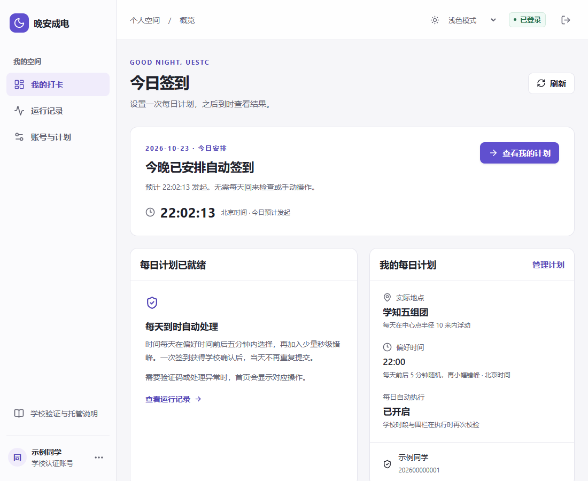

<div align="center">

# 晚安成电 · MoonUESTC

**管理学校认证、签到计划与学校确认记录。**

[](https://github.com/DonsonHH/MoonUESTC/actions/workflows/privacy-check.yml)
[](LICENSE)
[](requirements.txt)
[](docs/deployment.md)

[使用流程](docs/usage.md) · [部署指南](docs/deployment.md) · [系统设计](docs/architecture.md) · [私有管理](docs/private-admin.md)

<picture>
  <source media="(prefers-color-scheme: dark)" srcset="docs/images/dashboard-dark.png">
  
</picture>

</div>

## 当前学校入口要求

学校当前返回 `46001` 等打卡授权错误，要求在微信 **「成电智慧学工」小程序** 内进入打卡应用。学校密码校验成功、Cookie 有效，并不代表已获得打卡提交授权。

检测到此要求后，本站暂停自动提交，保留已有计划与历史记录。请在官方小程序中完成签到，再点击 **同步今日学校记录**。重新验证密码不会解除小程序入口要求；本站不会生成或伪造学校的操作凭证。

## 为什么用它

- **每天只签到一次**：首次设置地点与时间，完成一次校方确认的首签后，开启每日自动执行。
- **清楚的今日安排**：未到时间显示等待执行，完成后显示学校结果，异常时给出具体恢复操作。
- **每日随机、适度错峰**：在偏好时间前后五分钟内选择当天分钟，再加入 0–19 秒错峰；位置可在中心点半径 10 米内浮动。同日刷新、重试和重启使用同一安排。
- **保留学校原页面**：手机和电脑均可完成校方验证，不用装扩展或复制 Cookie。
- **轻量后台**：日常任务复用已保存的学校会话，通过单个 HTTP worker 处理；临时浏览器只服务本人参与的验证。
- **学生与管理端分离**：学生端可公开提供 HTTPS，管理端通过私有 SSH/Tailscale 转发访问。
- **浅深色与近期记录**：默认跟随系统；运行记录默认今天及前两天，更多历史按需加载。

## 三步开始

| 步骤 | 你要做的事 |
| --- | --- |
| 1 · 设置计划 | 用学号和学校密码完成身份验证，选择实际所在组团与偏好时间。 |
| 2 · 完成首签 | 在 21:06–23:24 内手动提交一次，系统同时校验学校时段与地点。 |
| 3 · 开启自动 | 学校确认首签后开启每日计划，之后按首页提示查看结果。 |

学校要求验证码或二次验证时，点击 **重新验证学校登录**。网络故障可延后重试一次；已有提交只复查结果，避免重复发送。

## 源码部署

需要 Docker、Compose v2 和学生端 HTTPS 域名。当前版本从源码构建，支持 ARM64 Jetson 和常规 amd64 服务器。

```sh
git clone https://github.com/DonsonHH/MoonUESTC.git
cd MoonUESTC
cp .env.example .env
mkdir -p data

docker build -t moonuestc-local:student-portal .
docker build -t moonuestc-browser:local browser_assist
```

先编辑 `.env`，填写 `MOON_PUBLIC_URL`、宿主机对应的 `PUID` / `PGID` 和随机的 `MOON_BROWSER_ASSIST_KEY`，再初始化管理员并启动：

```sh
docker compose -f compose.yaml -f compose.browser.yaml -f compose.admin.yaml run --rm moonuestc init-admin
docker compose -f compose.yaml -f compose.browser.yaml -f compose.admin.yaml up -d
```

学生服务默认绑定回环 `127.0.0.1:8088`，接入自己的 HTTPS 反向代理。管理服务只绑定 `127.0.0.1:4497`，通过私有转发访问。完整配置、更新与备份步骤见 [部署指南](docs/deployment.md)。

## 配置重点

| 设置 | 默认行为 |
| --- | --- |
| 学生范围 | 可按学号前缀限制；管理员可单独授权其他学号，所有用户仍需学校验证。 |
| 地点 | 当前部署选择学知二、五组团；每个账号仍按学校分配的围栏验证。 |
| 时间 | 21:06–23:24 内执行，偏好时间附近分配；临近截止保留重试余量。 |
| 随机位置 | 开启后半径 10 米，整个圆须落在本人实际范围和学校围栏内。 |
| 外观 | 跟随系统，也可在浏览器本地选择浅色或深色。 |

偏好时间附近无空闲窗口时，页面会提示调整，不会把计划静默移出所选范围。专属发起窗口受学校响应和网络耗时影响，签到结果以学校记录为准。

## 数据与授权

首次使用前展示托管说明，明确学校密码、Cookie、设备信息、姓名、地点和计划的保存用途。敏感登录资料加密保存在服务器，运营者维护时可访问；学生可暂停计划，管理员可删除账号及相关资料。备份与防重复状态的保留边界在说明中列明。

本服务由个人维护，非学校官方平台。使用本人或已获明确授权的账号，并遵守学校的时间和实际位置要求。

## 代码结构

```text
moonuestc/       学校客户端、认证、加密存储、每日调度与 Web API
frontend/       React 学生端和管理端
browser_assist/ 本人参与的学校原页面验证
scripts/        发布隐私门禁及其回归测试
tests/          离线后端回归
deploy/         私有管理转发与反向代理示例
docs/           使用、部署和系统说明
third_party/    实际依赖的版权与许可
```

## 开发与验证

```sh
python -m pip install -r requirements.txt
python -m unittest discover -s tests -v
python -m unittest discover -s scripts/tests -v
cd frontend
pnpm install --frozen-lockfile
pnpm build
node --experimental-strip-types --test tests/student-state.test.mjs
```

应用测试使用合成数据。浏览器验证的原生回归位于 `browser_assist/tests/test_navigation.py`，在带 Chromium 的 helper 镜像中运行。发布前配置本机 [隐私门禁](docs/privacy-release.md)，检查源码、全部待发布历史和当前实例的敏感匹配值。

## 许可与致谢

MIT。项目基于 [horoscope963852/MoonUESTC](https://github.com/horoscope963852/MoonUESTC) 演进，当前学生门户、设备验证、调度和管理流程由 Donson 维护。原作者及实际依赖的许可保留于 [LICENSE](LICENSE) 和 [THIRD_PARTY_NOTICES.md](THIRD_PARTY_NOTICES.md)。
